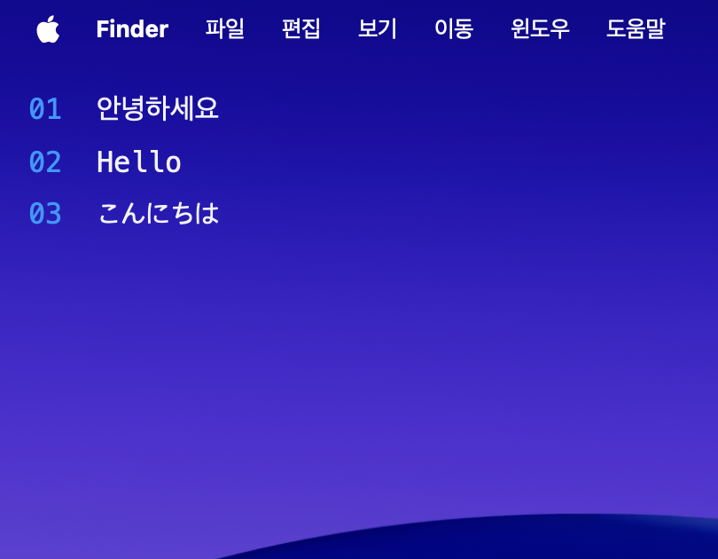

# Ultralist Übersicht Widget

> Display your [Ultralist](https://ultralist.io/) todos directly on your macOS desktop using [Übersicht](https://tracesof.net/uebersicht/).



---

## Features

- Live todo list on your desktop, refreshed every 10 seconds
- Color-coded IDs, projects (`+tag`), and contexts (`@tag`)
- Due date color indicators:
  - Yellow — upcoming
  - Orange + bold — due today
  - Red + bold — overdue
- Completed items hidden by default (configurable)
- Archived items hidden automatically
- Friendly error message if `~/.todos.json` is not found

---

## Requirements

| Tool | Notes |
|------|-------|
| [Übersicht](https://tracesof.net/uebersicht/) | Desktop widget engine |
| [Ultralist](https://ultralist.io/) | CLI todo manager |
| Python 3 | Available at `/usr/bin/python3` on macOS |

---

## Installation

**1. Install dependencies**

```sh
brew install ultralist
```

**2. Initialize Ultralist in your home directory**

```sh
cd ~ && ultralist init
```

**3. Clone into your Übersicht widgets folder**

```sh
git clone https://github.com/leejongyoung/ultralist-ubersicht-widget \
  ~/Library/Application\ Support/Übersicht/widgets/ultralist.widget
```

**4. Refresh Übersicht** — the widget will appear in the top-left corner.

---

## Usage

```sh
ultralist add "Fix the bug +work @urgent"
ultralist list
ultralist complete 1
```

Todos update on the desktop within 10 seconds.

---

## Configuration

Edit the top of `main.py` to adjust behavior and colors:

```python
# Display settings
line_spacing   = "10px"
show_completed = False  # Set to True to show completed todos

# Colors
color_id          = "#0099FF"   # todo ID
color_due         = "#f0d847"   # upcoming due date
color_due_today   = "#FF9500"   # due today
color_due_overdue = "#FF3B30"   # overdue
color_subject     = "#f2f3fa"   # todo text
color_project     = "#9dd6d8"   # +project tags
color_context     = "#c8c2df"   # @context tags
```

> Designed for dark desktop backgrounds.

---

## How It Works

```
ultralist → ~/.todos.json → main.py → HTML → Übersicht renders on desktop
```
